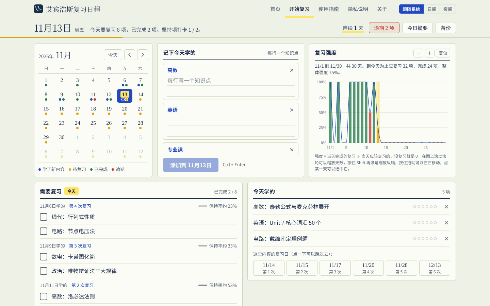
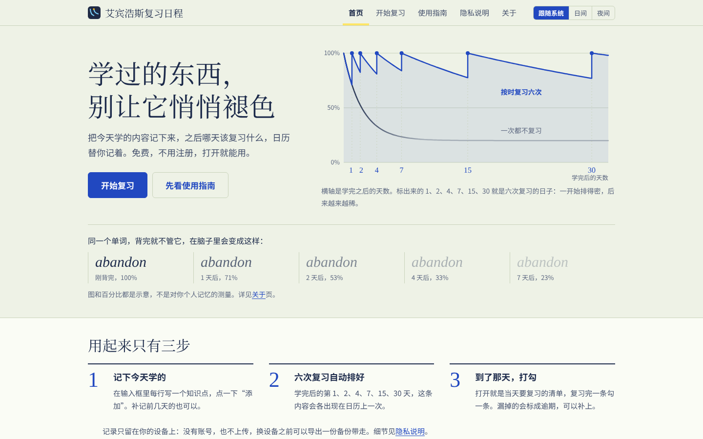
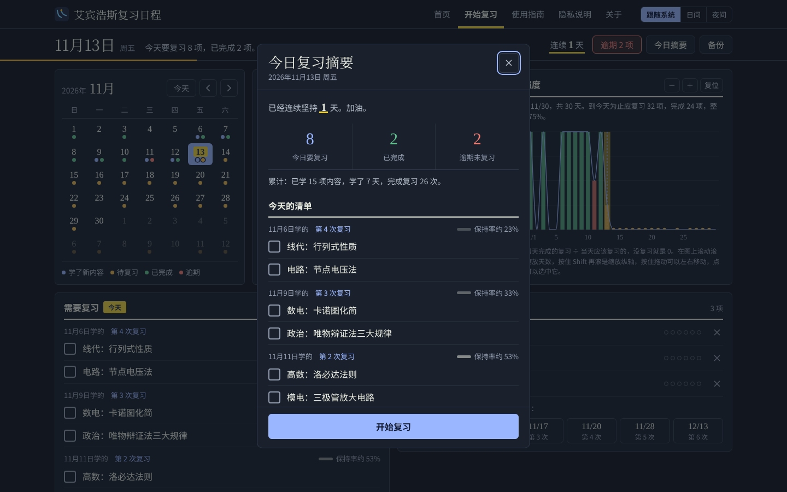

<div align="center">


# 艾宾浩斯复习日程

**把今天学的写下来，之后哪天该复习什么，日历替你记着。**

免费 · 不用注册 · 打开就能用 · 国内直接访问

[](https://sleepgenius07.github.io/)


### 👉 [立即开始复习](https://sleepgenius07.github.io/) 👈



</div>

---

## ✨ 它能帮你做什么

学过的东西忘得快，复习又容易拖。你只要**每天把学了什么写进去**，网站会按艾宾浩斯遗忘曲线，自动在学完后的 **第 1、2、4、7、15、30 天** 排好六次复习。之后每天打开，就知道今天该复习什么。

用起来只有三步：

1. **记下今天学的**：在科目框里每行写一个知识点，点"添加"。补记前几天的也可以。
2. **六次复习自动排好**：每条内容会在之后的六个复习日各出现一次。
3. **到了那天，打勾**：复习完一条勾一条，漏掉的会标成逾期，可以随时补上。

## 📸 界面预览

<table>
<tr>
<td width="50%"></td>
<td width="50%"></td>
</tr>
<tr>
<td align="center">首页：按时复习 vs 一次都不复习</td>
<td align="center">夜间模式 + 打开时自动弹出的今日复习摘要</td>
</tr>
</table>

## 🧩 功能一览

| 功能 | 说明 |
| --- | --- |
| 📅 **日历** | 彩色圆点标出每天的状态：学了新内容 / 待复习 / 已完成 / 逾期 |
| 📝 **科目框** | 一门课一个框，可以起名字；写得越多框越高（最多 12 行），最多建 12 个 |
| ✅ **坚持项** | 每天都要打卡的事（比如背单词），不参与艾宾浩斯排期；有 ON/OFF 开关 |
| 📈 **复习强度图** | 每天一根柱子加一条曲线，强度 = 当天完成的复习 ÷ 当天应该复习的；滚轮缩放、拖动查看 |
| 🔁 **复习清单** | 按学习日期分组，显示这是第几次复习，以及示意的记忆保持率 |
| 🔥 **进度与连续天数** | 顶部显示今天的复习进度、连续坚持天数；逾期内容可以在逾期清单里直接补勾 |
| 🔔 **今日复习摘要** | 打开网站时，如果今天有要复习的内容，会自动弹出摘要 |
| 💾 **备份** | 导出 / 导入备份文件，换设备也不丢记录（导入是合并，不会覆盖已有记录） |
| 🌗 **界面颜色** | 日间 / 夜间 / 跟随系统，每个页面顶部都能切换 |

整站设计成一本笔记本的样子：护眼纸的底色、蓝黑墨水的字、圆珠笔蓝的按钮，"今天"用荧光笔标出来。

## 🔒 隐私：你的记录只在你自己手里

- 没有账号系统，**不需要注册或登录**
- 学习记录保存在浏览器的本地存储（localStorage）里，**不会上传到任何服务器**，别人看不到
- 没有统计分析、广告或追踪脚本，也不设置 cookie
- ⚠️ 正因为数据只在本机，**清除浏览器数据或换设备前，请先导出一份备份**

详细说明见网站上的[隐私说明](https://sleepgenius07.github.io/privacy.html)。

## 📖 关于复习间隔和保持率

- **1、2、4、7、15、30 天**是一种常见的经验性安排，目的是让复习越来越稀疏。它不是艾宾浩斯原始实验里给出的数字，可以当作一个好用的起点。
- 应用里的"保持率"只是示意，用公式 `20% + 80% × e^(−0.45 × 天数)` 算出来，用来直观表示"隔得越久越容易忘"，并不是对个人记忆的测量。

更多背景见[关于页](https://sleepgenius07.github.io/about.html)。

## 🛠️ 技术与文件结构

纯 HTML + CSS + JavaScript，没有后端，没有框架，也不需要构建，托管在 GitHub Pages。

<details>
<summary>点开查看文件结构</summary>

| 文件 | 作用 |
| --- | --- |
| `index.html` + `home.css` | 首页 |
| `guide.html` / `privacy.html` / `about.html` | 使用指南、隐私说明、关于 |
| `style.css` | 全站共用样式（颜色、字体、导航栏、按钮） |
| `theme.js` | 界面颜色：日间 / 夜间 / 跟随系统 |
| `app/index.html` + `app/app.css` + `app/app.js` | 应用本身：日历、科目框、复习强度图、清单、弹窗 |
| `app/manifest.webmanifest` | 应用清单，支持"添加到主屏幕" |
| `screenshots/` | README 里用到的截图 |

</details>

**在本地运行：** 把仓库下载到电脑上，在文件夹里运行下面的命令，再用浏览器打开 `http://localhost:8000` 就行。

```bash
python -m http.server 8000
```

## 🤝 一起来改进

这是一个即将考研的工科生为了解决自己"学了就忘、复习就拖"做的小工具。如果它对你也有用，欢迎：

- 点一个 ⭐ **Star**，让更多人看到它
- 在 [Issues](https://github.com/sleepgenius07/sleepgenius07.github.io/issues) 里提建议、报 bug
- **Fork** 之后改出你自己的版本，或者提交 Pull Request 一起完善

---

<div align="center">
<sub>© 2026 sleepgenius07 · 祝你学过的东西，都不会悄悄褪色</sub>
</div>
